# Production RAG Platform — Architecture, Stack and Flows

> Scope: cloud-hosted, multi-tenant, observable, traceable RAG implementing every technique from the guide (PageIndex, Multivector, Metadata Augmentation, CAG, Contextual Retrieval, Reranking, Hybrid RAG, Self-Reasoning, Adaptive/Iterative RAG, Graph RAG, Query Rewriting, BM25) plus the appendix items.
> Cloud: **AWS** (primary region `ap-south-1`; use Bedrock cross-region inference profiles where a model is not available in-region). Everything below maps 1:1 to GCP/Azure equivalents if you switch.

---

## 1. Technique → Component Map

| # | Technique | Ingestion side | Query side | Storage |
|---|-----------|----------------|------------|---------|
| 1 | PageIndex | Heading-tree builder + bottom-up node summaries | `pageindex_retrieve`: LLM reasons over tree, picks nodes | Postgres `tree_nodes`, S3 tree JSON |
| 2 | Multivector | Per chunk: content, summary, keywords, hypothetical questions → separate embeddings | Query hits all representations, grouped by `chunk_id` | Qdrant (one point per chunk x representation) |
| 3 | Metadata augmentation | Enrich: source, dates, author, dept, entities, ACL, quality score, tags | Self-query filters extracted by LLM; usage counters updated | Qdrant payload + Postgres |
| 4 | CAG | Curate "cold" docs into a versioned knowledge pack | `CAG` route: pack becomes cached prompt prefix | S3 pack + provider prompt cache (or vLLM prefix cache) |
| 5 | Contextual Retrieval | LLM writes 50–100 token context prefix per chunk before embedding | Retrieval over contextualised text (dense + BM25) | Qdrant |
| 6 | Reranking | — | Cross-encoder rerank of fused candidates | Bedrock Cohere Rerank |
| 7 | Hybrid RAG (vector + graph) | Entity/relation extraction → graph | Parallel vector + graph retrievers, RRF merge | Qdrant + Neo4j |
| 8 | Self-Reasoning (RAP/EAP/TAP) | — | `self_reason` node (RAP + EAP), `generate` node (TAP) | — |
| 9 | Adaptive / Iterative RAG | — | Complexity router + bounded retrieval loop with escalation | — |
| 10 | Graph RAG | KG extraction, community detection + summaries | k-hop traversal, community summaries for global questions | Neo4j |
| 11 | Query rewriting | — | Coref resolution, decomposition, filter extraction, domain terms | — |
| 12 | BM25 | Sparse vectors built from contextualised text | Dense + sparse prefetch, RRF fusion in one Qdrant call | Qdrant sparse vectors (IDF modifier) |

**Appendix techniques**

| Technique | Decision |
|-----------|----------|
| Embedding model optimisation | Benchmark 2–3 embedders on *your* golden set (not MTEB). Re-embed via blue/green collection + alias swap. |
| Late chunking | Optional chunk strategy for long docs (Jina v3 `late_chunking` or Voyage contextual embeddings). Feature-flagged per doc type. |
| Document preprocessing | Docling (layout, tables, headings) + Textract OCR fallback; table-aware serialisation; VLM captions for figures. |
| Fusion-in-Decoder (FiD) | **Not feasible with hosted API LLMs** (requires encoder-decoder fine-tune). Approximation: per-document map step (`EAP`) then reduce in generation. |
| RAG-Token / RAG-Sequence | **Model-architecture level, not applicable** to API LLMs. Approximation: RAG-Sequence ≈ pick best doc set then generate once; RAG-Token ≈ not reproducible. |

> Reality check: the guide's numbers (98%, 49%, 67%…) are vendor/benchmark-specific. Put every technique behind a feature flag and **prove its marginal value on your own eval set** (Section 9).

---

## 2. Tech Stack

### 2.1 Core stack

| Layer | Choice | Why | Alternative |
|-------|--------|-----|-------------|
| Language / API | Python 3.12, FastAPI, Pydantic v2, uvicorn + gunicorn | You already know it; async + SSE streaming | — |
| Query orchestration | **LangGraph** (+ LangChain components), Postgres checkpointer | Cyclic graphs (iterative RAG), state, retries, human-in-loop later | Plain asyncio state machine |
| Ingestion orchestration | **Temporal Cloud** | Durable workflows, per-activity retries, idempotency, visibility | SQS + Celery (leaner), Step Functions |
| Document parsing | **Docling** + AWS Textract (scanned fallback) | Layout + table aware, OSS | Unstructured, LlamaParse |
| LLM access | **Amazon Bedrock** (Claude family) behind **LiteLLM proxy** | IAM/VPC private, no key sprawl; LiteLLM gives routing, fallbacks, budgets, per-tenant keys | Direct Anthropic/OpenAI/Gemini APIs |
| Self-hosted inference (optional, later) | vLLM / SGLang on EKS GPU nodes | True KV-cache CAG, cost control at scale | — |
| Embeddings | Cohere Embed (Bedrock) or Voyage; BGE-M3 self-hosted as fallback | Strong multilingual/long context | OpenAI text-embedding-3-large |
| Reranker | Cohere Rerank 3.5+ (Bedrock) | Managed, low latency | Voyage rerank, `bge-reranker-v2-m3` self-hosted |
| Vector + sparse store | **Qdrant Cloud (AWS)** | Named dense vectors, sparse BM25 (IDF), multivector, prefetch + RRF, payload indexes, `is_tenant` indexing, group-by | OpenSearch (BM25 + kNN), pgvector for small scale |
| Knowledge graph | **Neo4j AuraDB** | Mature Cypher, GDS (Leiden communities), LangChain integration | Neptune, Memgraph |
| Relational / audit | **Aurora PostgreSQL** (RLS, JSONB, `ltree`) | Metadata, trees, lineage, audit, eval results, conversation memory | RDS Postgres |
| Object store | **S3** (versioning, KMS, lifecycle, Object Lock for audit exports) | Raw docs, parsed JSON, trees, CAG packs | — |
| Cache / sessions / limits | **ElastiCache Redis (or Valkey)** | Exact-match cache, session memory, rate limits | Upstash |
| Semantic cache | Dedicated Qdrant collection | Reuses existing infra, filter by tenant/ACL/corpus version | Redis vector search |
| Messaging | EventBridge + SQS (+ DLQs) | S3 event fan-in, backpressure | — |
| Auth | Cognito or Auth0 (OIDC/JWT), API keys for service clients | Tenant + group claims | Clerk, Keycloak |
| Edge | Route 53 → CloudFront + WAF + Shield → ALB | TLS, bot/DDoS protection | API Gateway |
| Guardrails | Bedrock Guardrails or LLM Guard; Presidio (PII) | Input + output policy, prompt injection | NeMo Guardrails |
| Tracing / LLM obs | **OpenTelemetry** + **Langfuse** (OTLP ingest) | One trace_id edge-to-store; prompt registry, cost, scores, datasets | LangSmith |
| Metrics / logs / APM | Prometheus (AMP) + Grafana (AMG) + Tempo + Loki, or Datadog | SLOs, dashboards, alerting | CloudWatch only (simpler) |
| Errors / paging | Sentry, PagerDuty or Opsgenie | — | — |
| Eval | Ragas + DeepEval, golden set in Langfuse Datasets | CI gate + online sampling | TruLens |
| IaC | Terraform, Secrets Manager, KMS | — | CDK |
| Compute / deploy | ECS Fargate, GitHub Actions → ECR → CodeDeploy blue/green | Low ops for solo/small team | EKS + ArgoCD at scale |
| Frontend (optional) | Next.js + Vercel AI SDK (SSE) | — | — |

### 2.2 LLM roles (model tiers, not versions — pin versions in config)

| Role | Used in | Tier | Notes |
|------|---------|------|-------|
| Router / rewriter / entity extractor / filter extractor | Query | Small, fast | JSON-schema structured output, temperature 0 |
| Tree navigator | PageIndex | Mid | Reasoning quality matters more than speed |
| Self-reasoning RAP + EAP | Query | Mid | Per-doc relevance reasoning + evidence sentence selection |
| Generator (TAP) | Query | Mid / top | Streaming; static prefix prompt-cached |
| Verifier (groundedness) | Query | Small | Inline; must be cheap |
| Offline / online judge | Eval | Strong, **different family from generator** | Avoids self-preference bias |
| Contextualiser, summariser, question-gen, KG extractor | Ingestion | Small, batch | Prompt-cache the document prefix; use Bedrock batch inference where available |

### 2.3 CAG — practical note

- True CAG = persistent KV cache → needs self-hosted vLLM/SGLang (prefix caching, optionally LMCache).
- On Bedrock/Anthropic, CAG = **prompt caching** of the knowledge-pack prefix. Cache TTL is minutes-scale → run a keep-warm ping for hot tenants.
- Pack must fit comfortably in context (budget ≤ ~100–150K tokens) and change rarely (compliance rules, product manuals, policies). Anything volatile stays in RAG.

---

## 3. System Architecture

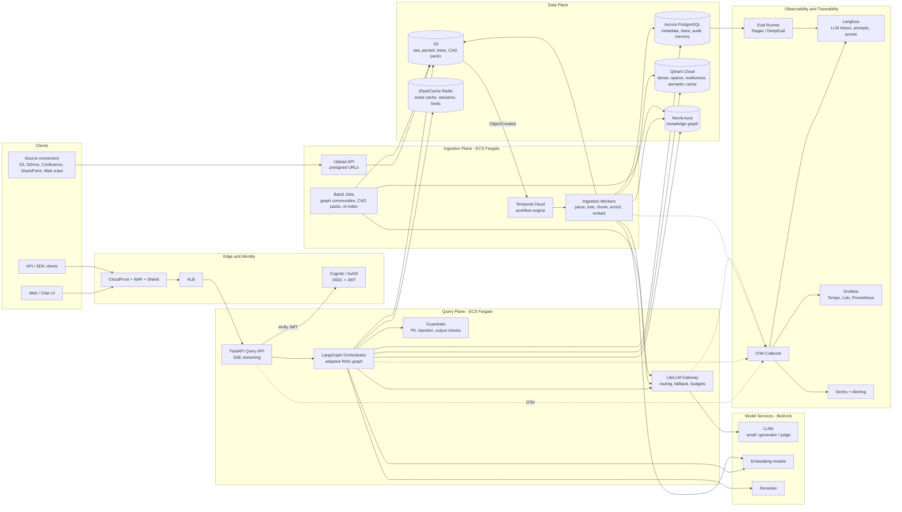

---

## 4. Cloud Deployment Topology

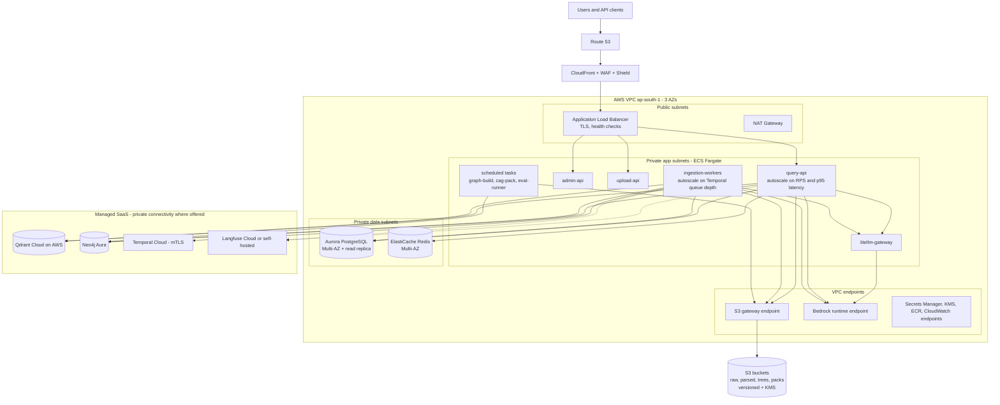

---

## 5. Ingestion Pipeline

### 5.1 Stage flow

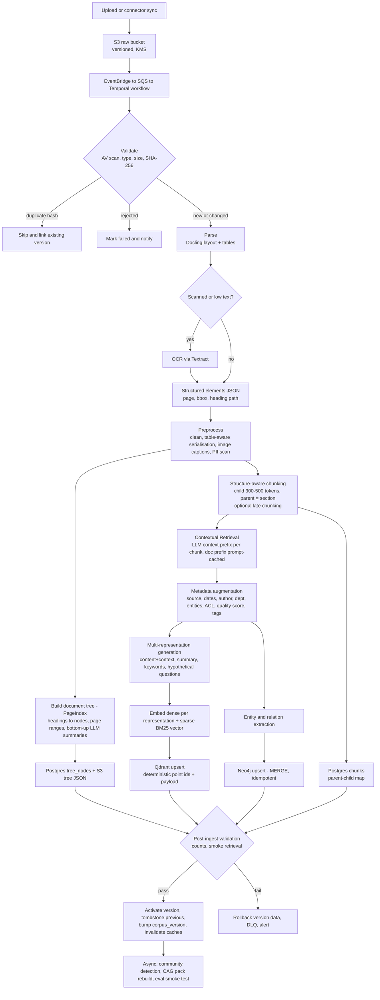

### 5.2 Ingestion sequence

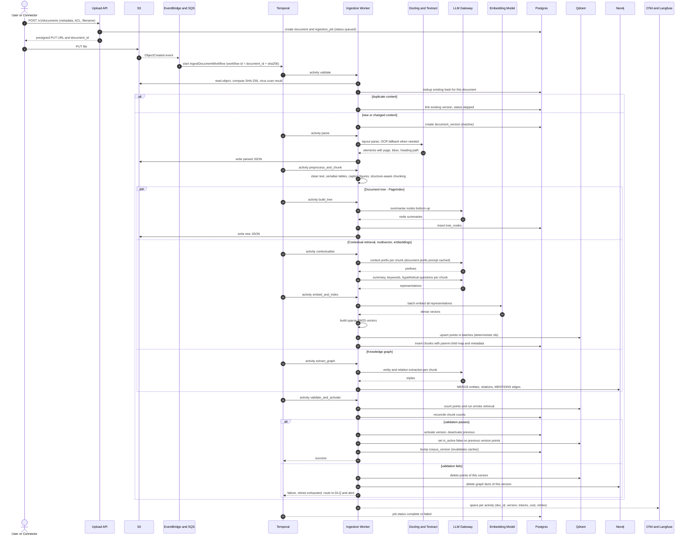

---

## 6. Query Pipeline

### 6.1 Adaptive router

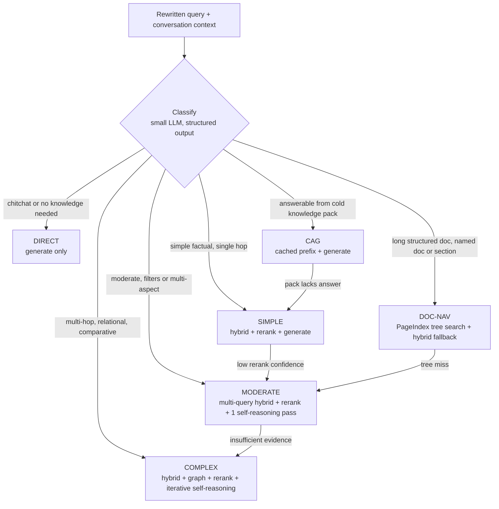

### 6.2 LangGraph state graph

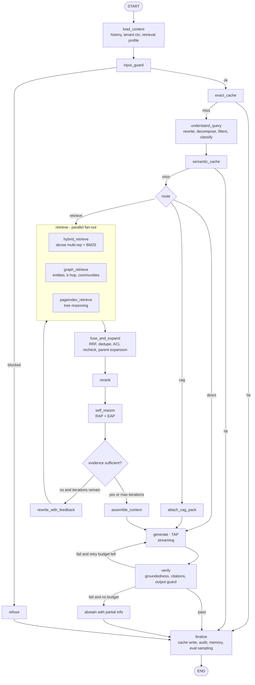

### 6.3 COMPLETE query sequence

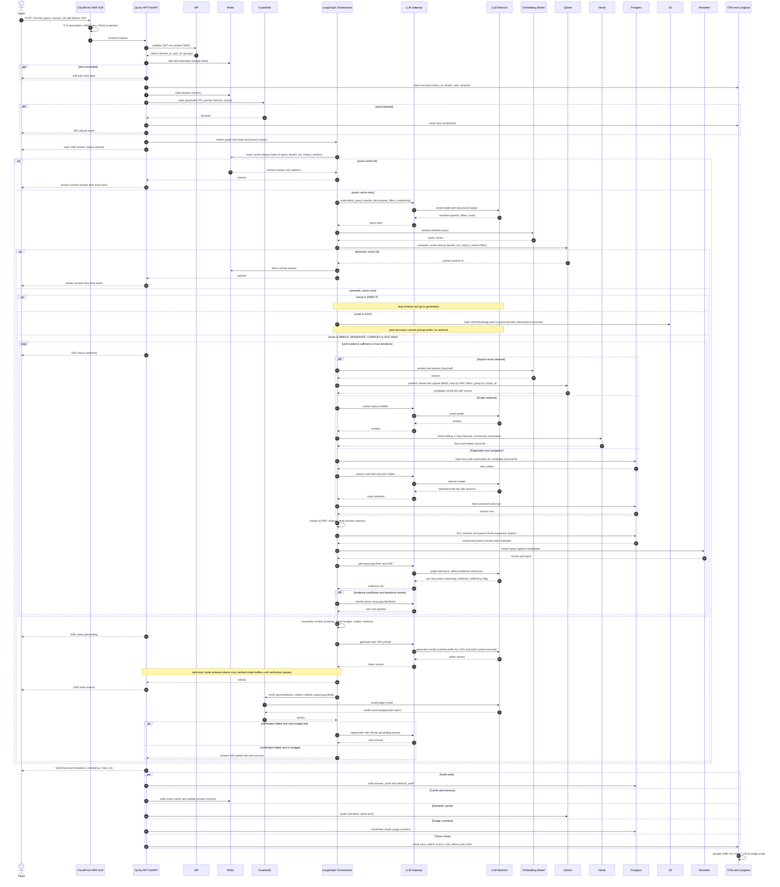

### 6.4 LangGraph state (Pydantic model fields)

| Field | Type | Set by |
|-------|------|--------|
| `tenant_ctx` | `{tenant_id, user_id, groups, corpus_version}` | `load_context` (immutable, passed to every store call) |
| `retrieval_profile` | feature flags + limits | `load_context` |
| `query_raw`, `history` | str, list | API |
| `plan` | `{rewrites[], sub_queries[], filters, route, complexity}` | `understand_query` |
| `candidates` | list of `{chunk_id, source, score}` | retrievers |
| `ranked` | list of parent chunks + rerank score | `rerank` |
| `evidence` | list of `{chunk_id, sentences[], reason}` | `self_reason` |
| `sufficient`, `iteration`, `gap_feedback` | bool, int, str | `self_reason`, `rewrite_with_feedback` |
| `context_blocks`, `cag_pack_id` | list, str | `assemble_context`, `attach_cag_pack` |
| `answer`, `citations`, `verdict` | str, list, enum | `generate`, `verify` |
| `trace_id`, `cost`, `latency_by_node` | str, float, dict | observability middleware |

### 6.5 Retrieval profile (feature flags per tenant or per request)

| Flag | Default | Purpose |
|------|---------|---------|
| `use_contextual`, `use_multivector`, `use_bm25` | on | Core retrieval quality |
| `use_rerank` | on | Precision |
| `use_graph`, `use_pageindex`, `use_cag` | route-dependent | Advanced paths |
| `use_self_reasoning`, `max_iterations` | on, 3 | Quality vs latency |
| `stream_mode` | `optimistic` or `verified` | Latency vs safety |
| `top_k_retrieve`, `top_k_rerank` | 50–100, 8–10 | Recall / context budget |

Every flag is also the unit of ablation in the eval harness.

---

## 7. Data Model

### 7.1 Postgres (system of record, lineage, audit)

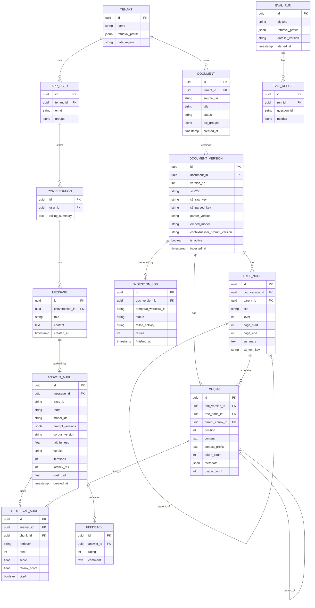

Rules: Row-Level Security on `tenant_id` for every table. `answer_audit` and `retrieval_audit` are append-only (no UPDATE/DELETE grants), exported nightly to S3 with Object Lock.

### 7.2 Qdrant

| Item | Design |
|------|--------|
| Collection | `chunks_v{N}` behind alias `chunks_live` (blue/green re-index: build `v{N+1}`, validate, swap alias) |
| Points | One per **(chunk x representation)**: `rep_type` ∈ `content`, `summary`, `question`, `keywords` |
| Named vectors | `dense` (cosine, dim of chosen embedder), `sparse_bm25` (sparse, `modifier: idf`). Optional `colbert` multivector (MaxSim) for late-interaction rescoring |
| Point id | Deterministic: `uuid5(doc_version_id, chunk_position, rep_type, rep_index)` → idempotent upserts |
| Query | `query_points` with `prefetch` (dense per rep, sparse) → RRF fusion → `group_by chunk_id` |
| Payload (indexed) | `tenant_id` (`is_tenant`), `acl_groups`, `doc_id`, `doc_version_id`, `is_active`, `chunk_id`, `rep_type`, `doc_type`, `department`, `author`, `created_at`, `entities`, `tags`, `quality_score`, `corpus_version` |
| Semantic cache | Separate collection `semantic_cache`: query vector + payload `{tenant_id, acl_hash, corpus_version, answer_ref, ttl}`; similarity threshold set high, tuned on eval set |

### 7.3 Neo4j

| Element | Design |
|---------|--------|
| Nodes | `Entity {id, tenant_id, name, type, aliases, embedding}`, `Chunk {id, tenant_id}`, `Document {id, tenant_id}`, `Community {id, level, summary}` |
| Edges | `(Entity)-[:RELATES {type, weight, doc_version_ids}]->(Entity)`, `(Chunk)-[:MENTIONS]->(Entity)`, `(Chunk)-[:PART_OF]->(Document)`, `(Entity)-[:IN_COMMUNITY]->(Community)` |
| Ontology | Fixed, small entity/relation type set per domain (controls extraction cost and noise) |
| Communities | Leiden via GDS in nightly batch → LLM summaries per community → used for "global" questions |
| Safety | All Cypher built from parameterised templates that **require** `tenant_id`; never string-concatenate LLM output into Cypher |
| Deletion | Edges carry `doc_version_ids`; removing a version decrements/prunes edges |

---

## 8. Observability and Traceability

**Observability** = see what the system is doing. **Traceability** = reconstruct *why* a specific answer was produced, months later.

### 8.1 Telemetry pipeline

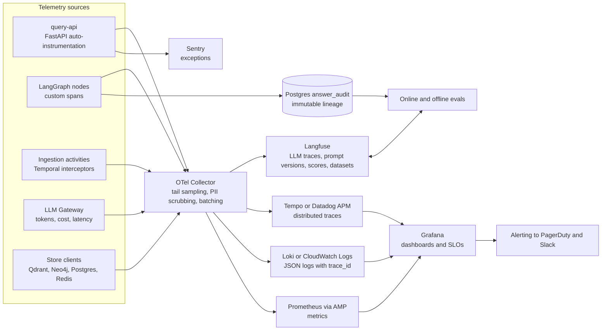

### 8.2 Span taxonomy

| Span | Key attributes |
|------|----------------|
| `http.request` | `tenant_id`, `user_id`, `session_id`, status, bytes |
| `graph.node.<name>` | `route`, `iteration`, latency |
| `llm.call` | `role`, `model`, `prompt_name`, `prompt_version`, tokens in/out, cached tokens, TTFT, cost |
| `embed.call` | model, batch size, tokens |
| `qdrant.query` | collection, vectors used, filter hash, k, hits, latency |
| `neo4j.query` | cypher template id, hops, rows |
| `rerank.call` | model, n candidates, top score |
| `cache.lookup` | tier (`exact`, `semantic`, `cag`), hit, similarity |
| `guard.check` | type (`input`, `output`), verdict |
| `verify.groundedness` | score, unsupported claim count |
| `ingest.activity.<name>` | `doc_id`, `version`, retries, tokens, cost |

Rules: `trace_id` is generated at the edge, propagated via W3C `traceparent`, returned to the client in the final SSE event, and stored in `answer_audit`. Prompts are fetched from the Langfuse prompt registry and **version-pinned per deployment**.

### 8.3 Metrics and SLOs

| Category | Metrics |
|----------|---------|
| Latency | p50/p95/p99 per route and per node; TTFT; end-to-end |
| Quality (online) | Faithfulness, answer relevance (sampled LLM-judge), abstain rate, groundedness-fail rate, thumbs-down rate |
| Retrieval | Hit rate per retriever, rerank score distribution, iterations per query, router distribution, escalations |
| Cache | Exact / semantic / CAG hit rate; false-hit reports |
| Cost | Tokens and USD per query, per tenant, per route, per ingestion document |
| Ingestion | Queue depth, ingestion lag, success rate, DLQ size, parse failures by type |
| Infra | Saturation, error rate per dependency, circuit breaker state |

| SLO (starting targets) | Target |
|------------------------|--------|
| Availability (query API) | 99.9% |
| p95 TTFT, simple route | under 2.5 s |
| p95 end-to-end, complex route | under 12 s (progress events streamed) |
| Online faithfulness (sampled) | at or above 0.90 |
| Ingestion lag p95 (standard doc) | under 5 min |

### 8.4 Lineage: auditing a bad answer

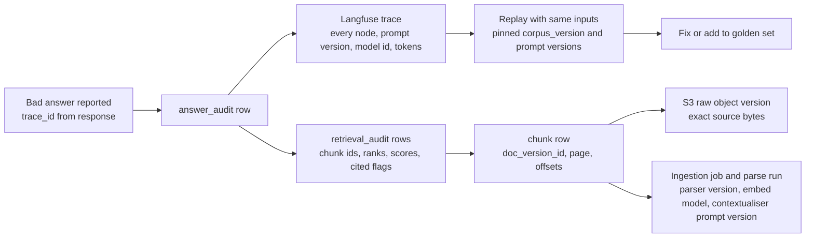

---

## 9. Evaluation

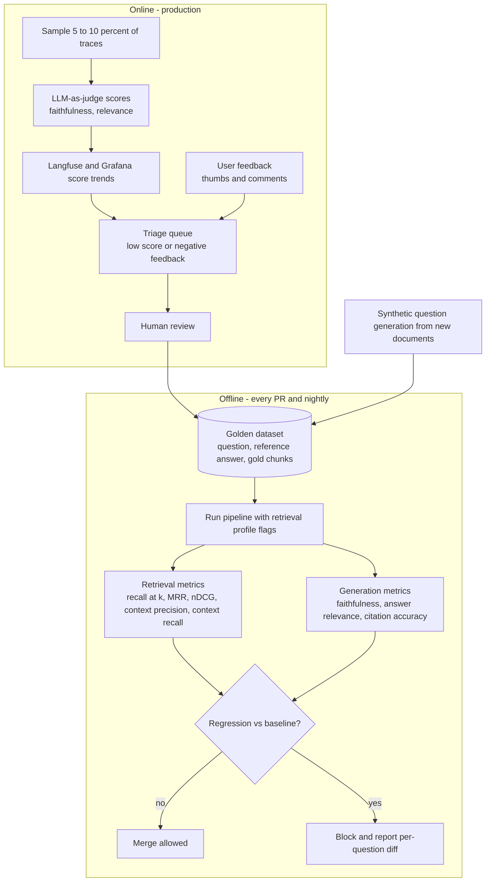

- Start the golden set at 100–200 real-style questions (mix of simple, multi-hop, table, long-doc, "not in corpus"). Include **unanswerable** questions to test abstention.
- Ablation matrix: run the set with each flag toggled; keep a technique only if it moves a metric that matters for its target failure mode.
- Human-validate the judge periodically (guide's DoorDash point): sample judge scores, compare to human labels, track agreement.

---

## 10. Security, Tenancy, Guardrails

| Area | Design |
|------|--------|
| Tenant isolation | `tenant_id` from JWT only → immutable `TenantContext` required by every repository method. Qdrant `is_tenant` payload filter, Postgres RLS, Neo4j templated Cypher. Large tenants → own Qdrant collection |
| Document ACL | `acl_groups` in payload for pre-filtering **and** re-checked against Postgres after retrieval (defence in depth) |
| Prompt injection | Retrieved text is untrusted: delimited, no tool execution driven by it, output verified against evidence, input classifier on queries |
| PII | Presidio scan at ingest (tag or redact per policy) and on I/O; OTel Collector scrubs attributes |
| Secrets / keys | Secrets Manager, IAM task roles, no static keys; per-tenant LiteLLM virtual keys with budgets |
| Network | Private subnets, VPC endpoints, PrivateLink for SaaS where available, WAF managed rules, rate limits per tenant and per IP |
| Encryption | TLS everywhere, KMS on S3/Aurora/EBS, Qdrant/Neo4j encryption at rest |
| Erasure (GDPR / India DPDP) | `DeleteDocumentWorkflow`: S3 versions → Postgres rows → Qdrant points → Neo4j facts → caches → audit pseudonymisation. Verified by a post-delete scan |
| Supply chain | Image scan (Trivy), `pip-audit`, Dependabot, signed images |
| Audit | Append-only audit tables + S3 Object Lock exports |

---

## 11. Reliability, Scaling, Cost

### 11.1 Degradation matrix

| Dependency down | Behaviour |
|-----------------|-----------|
| Reranker | Fall back to RRF order; flag `degraded=reranker` in trace |
| Neo4j | Skip graph retriever; route COMPLEX → MODERATE settings |
| PageIndex path (LLM slow) | Timeout → hybrid only |
| Verifier / judge model | Skip verification, set `verified=false` in final event; alert |
| Primary LLM | LiteLLM fallback chain (alternate Bedrock model, then direct API) |
| Qdrant | Fail fast 503 (no silent wrong answers); semantic/exact cache may still serve |
| Redis | Bypass caches and rate limiter fails open with strict per-instance limits |
| Temporal / ingestion | Queries unaffected; uploads queue and retry |

### 11.2 Practices

- Timeouts and retries with jitter on every client; circuit breaker per dependency; bulkheads (separate pools per store).
- Idempotent ingestion: deterministic IDs, Temporal activity retries, DLQ with replay tool.
- Cache keys include `corpus_version` and ACL hash → ingestion automatically invalidates stale answers.
- Reindex / embedder migration: build new collection, dual-validate on golden set, atomic alias swap, keep old for rollback.
- Cost levers: small models for routing/extraction, prompt caching for ingest and static prefixes, batch inference for ingestion LLM calls, cap `max_iterations`, route by complexity, semantic cache, embedding cache by content hash.
- Load: k6 scenarios per route; autoscale query-api on RPS + p95, workers on queue depth.

### 11.3 Latency budget (targets)

| Route | Steps | TTFT target |
|-------|-------|-------------|
| DIRECT | rewrite → generate | under 1 s |
| CAG | rewrite → cached-prefix generate | under 1.5 s |
| SIMPLE | rewrite → hybrid → rerank → generate | under 2.5 s |
| MODERATE | + multi-query, 1 self-reasoning pass | 3–5 s |
| COMPLEX / DOC-NAV | + graph / tree, iterative loop | 6–10 s (stream status events) |

---

## 12. API Contract

| Endpoint | Purpose |
|----------|---------|
| `POST /v1/chat` (SSE) | Events: `status`, `token`, `citation`, `verification`, `final` (includes `trace_id`, `confidence`, `route`) |
| `POST /v1/documents` | Create doc + presigned upload URL |
| `GET /v1/documents/{id}/status` | Ingestion stage, version, errors |
| `DELETE /v1/documents/{id}` | Erasure workflow |
| `POST /v1/feedback` | Rating + comment keyed by `trace_id` |
| `GET /v1/traces/{trace_id}/audit` | Lineage (admin) |
| `POST /v1/admin/retrieval-profile` | Per-tenant flags |
| `POST /v1/admin/cag-pack/rebuild` | Rebuild cold pack |

---

## 13. Code Organisation (monorepo)

| Path | Contents |
|------|----------|
| `apps/query_api` | FastAPI app, auth middleware, SSE, rate limits |
| `apps/ingestion_worker` | Temporal worker + activities |
| `apps/batch_jobs` | Graph communities, CAG packs, evals, re-index |
| `apps/admin_api` | Tenants, docs, feedback, audit |
| `packages/core` | Settings, Pydantic models, errors, `TenantContext` |
| `packages/graph_flow` | LangGraph state, nodes, edges, routing |
| `packages/retrieval` | Hybrid, graph, PageIndex, fusion, rerank, cache |
| `packages/ingestion` | Parsers, chunkers, contextualiser, enrichers, tree builder, KG extractor |
| `packages/llm` | Gateway client, structured-output helpers, prompt loader (Langfuse) |
| `packages/guardrails` | Input/output checks, PII |
| `packages/observability` | OTel setup, span decorators, metrics, Langfuse client |
| `packages/evals` | Datasets, metrics, ablation runner |
| `infra/terraform` | All AWS + SaaS provisioning |
| `prompts/` | Versioned prompt sources synced to Langfuse |
| `datasets/golden` | Eval data |
| `tests/` | unit, integration (testcontainers), e2e, load |

Conventions: repository pattern per store (all take `TenantContext`), ports/adapters so any store/model is swappable, structured outputs everywhere (Pydantic schemas), no prompt strings inline.

---

## 14. CI/CD and IaC

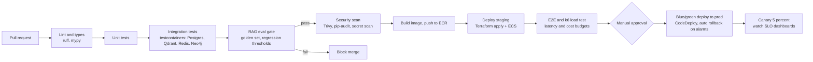

Environments: `dev` (shared SaaS dev projects), `staging` (prod-like, synthetic data), `prod`. Separate AWS accounts + Terraform workspaces. Config via env + Secrets Manager; prompts and retrieval profiles are versioned artefacts.

---

## 15. Build Roadmap (indicative, solo/small team)

| Phase | Deliver | Exit criteria |
|-------|---------|---------------|
| 0. Skeleton (1–2 wks) | Terraform baseline, VPC, ECS, Aurora, S3, Qdrant/Neo4j/Temporal accounts, auth, OTel + Langfuse, CI/CD, **golden set v0 + eval harness** | Hello-world query traced end to end; eval runs in CI |
| 1. Foundation (2–3 wks) | Docling parsing, structure-aware chunking, contextual retrieval, metadata, dense + BM25 hybrid, rerank, cited streaming generation, ingestion workflow with validation | Beats naive-RAG baseline on golden set; ingestion idempotent and observable |
| 2. Intelligence (2 wks) | Query rewriting, adaptive router, exact + semantic cache, guardrails, verifier, self-reasoning (RAP/EAP/TAP), iterative loop | Latency per route within budget; abstains on unanswerable set |
| 3. Advanced (3–4 wks) | PageIndex tree + navigator, multivector representations, Graph RAG (+ communities), CAG pack + prompt cache | Each technique shows measurable lift on its target failure slice, else disabled |
| 4. Hardening (2 wks) | Load + chaos tests, degradation paths, cost tuning, DR (Aurora PITR, S3 versioning, Qdrant snapshots), security review, SLO dashboards + alerts, runbooks | SLOs met under load; restore drill passed |

---

## 16. Key Decisions and Risks

| Decision / risk | Position |
|-----------------|----------|
| One vector store for dense + sparse + multivector + cache | Qdrant keeps ops small; revisit OpenSearch only if you need heavy lexical features (analyzers, synonyms) |
| Temporal vs SQS + Celery | Temporal for durable multi-step ingestion; Celery is acceptable if you want fewer moving parts |
| PageIndex cost | Per-node LLM summarisation and per-query LLM navigation are expensive → apply only to long structured docs; route via DOC-NAV |
| Graph RAG cost / noise | Fixed ontology, small extraction model, batch inference, only enable for tenants whose queries are relational |
| Streaming vs verification | `optimistic` for UX, `verified` for regulated tenants |
| CAG on managed APIs | Prompt caching is a proxy for true KV-cache CAG; TTL short → keep-warm or self-host |
| FiD / RAG-Token | Not possible on hosted LLMs; documented approximations only |
| Semantic cache false hits | Tenant + ACL + corpus_version in key, high threshold, log hits for review |
| Vendor claims | Treat as hypotheses; your golden set decides |
| Open choices for you | AWS vs GCP, Langfuse Cloud vs self-host, Qdrant Cloud vs OpenSearch, Temporal vs Celery |